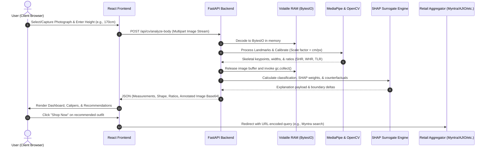

# Data Flow Specification | Style AI Explainable AI Fashion Advisor

## 1. End-to-End Analysis Workflow

---

## 2. Step-by-Step Data Transformations

### Step 1: Input Ingestion & Privacy Isolation
- Client uploads or captures an image (`multipart/form-data`).
- Backend streams the payload directly into an in-memory `io.BytesIO` buffer.
- `PrivacyImageProcessor.load_and_validate_image` verifies MIME type (`image/jpeg`, `image/png`, `image/webp`) and enforces size ceiling ($\le 10\text{ MB}$).

### Step 2: Computer Vision Inference
1. **Pose & Silhouette Detection**:
   - `MediaPipe Pose` identifies 33 full-body landmarks.
   - Computes pixel distance across shoulders (11-12) and hips (23-24).
   - Pixel height is mapped to user physical height in cm:
     $$\text{cm\_per\_pixel} = \frac{\text{Height}_{\text{user}}}{\text{Height}_{\text{pixels}}}$$
   - Computes physical widths: Shoulder ($W_{sh}$), Hip ($W_{hp}$), Waist ($W_{w}$), and Chest ($W_{ch}$).
2. **Skin Chromaticity & Monk Scale**:
   - `MediaPipe FaceMesh` locates facial regions: Forehead, Left Cheek, Right Cheek.
   - Applies Gray-World white balance correction to strip environmental tinting.
   - Converts median patch values to CIELAB ($L^*, a^*, b^*$).
   - Finds minimum Delta E ($\Delta E_{00}$) across the 10 Monk Skin Tone reference brackets.
   - Evaluates chromatic axes ($a^*$ red/green, $b^*$ yellow/blue) to identify undertone: Warm, Cool, Neutral, or Olive.

### Step 3: Explainable AI & Rule-Based Synthesis
- Evaluates body ratios against calibrated anthropometric thresholds:
  - Female: Hourglass, Pear, Apple, Rectangle, Inverted Triangle.
  - Male: Trapezoid, Rectangle, Triangle, Inverted Triangle, Oval.
- Computes SHAP values using a surrogate Decision Tree model via `shap.TreeExplainer`.
- Computes counterfactual perturbations indicating exact ratio shifts needed to transition classification categories.

### Step 4: Multi-Store Search Encoding
- Generates retail search links using `urllib.parse.quote_plus`:
  - Myntra: `https://www.myntra.com/{query}`
  - AJIO: `https://www.ajio.com/search/?text={query}`
  - Meesho: `https://www.meesho.com/search?q={query}`
  - Flipkart: `https://www.flipkart.com/search?q={query}`
  - Amazon: `https://www.amazon.in/s?k={query}`
