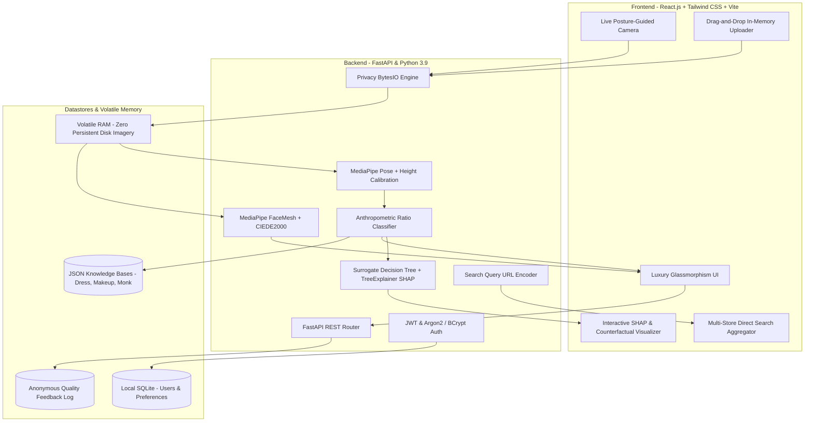

# System Architecture | Style AI Explainable AI Fashion & Makeup Advisor

## 1. Architectural Overview

Style AI is an enterprise-grade, full-stack fashion-tech platform built to deliver anthropometric body shape classification, Monk scale skin tone mapping, and explainable AI recommendations across both Men's and Women's fashion and cosmetics.

---

## 2. Layer Specifications

### 2.1 Frontend Presentation Layer (React 19, Tailwind CSS v4, Vite)
- **Design Language**: Warm Ivory (`#FAF8F5`), Champagne Gold (`#D4AF37`), Soft Beige (`#EFECE6`), Rose Gold (`#B76E79`), and Deep Burgundy (`#631B2A`).
- **Typography**: Cormorant Garamond for luxury serif editorial headings; Plus Jakarta Sans for crisp, legible UI copy.
- **Micro-Interactions**: Real-time camera guides with countdown timer, glassmorphism overlays, and Recharts horizontal bar charts for SHAP feature weights.
- **State Management**: React Context (`AuthContext`) handling session authentication tokens and active in-session analysis models.

### 2.2 Backend Application Layer (FastAPI, Uvicorn, Pydantic v2)
- **High Concurrency**: Asynchronous endpoints handling multipart image streaming directly in memory.
- **RESTful Endpoints**:
  - `/api/auth/*`: Registration, login, JWT issuance, profile updates, and GDPR account deletion.
  - `/api/cv/analyze-body`: MediaPipe Pose skeletal joint detection, height calibration, and measurement table generation.
  - `/api/cv/analyze-skin`: MediaPipe FaceMesh extraction, Gray-World illumination correction, and CIEDE2000 Monk scale matching.
  - `/api/recommendations/*`: Filtered fashion and cosmetic items with occasion and budget ranking.
  - `/api/xai/*`: TreeExplainer SHAP calculations, counterfactual delta perturbations, and rule-based tracing.
  - `/api/shopping/links`: Real-time query encoding for Myntra, AJIO, Meesho, Flipkart, and Amazon India.

### 2.3 Artificial Intelligence & Color Science Engines
1. **Pose & Silhouette Calibrator**:
   - Computes keypoint coordinates for shoulders, hips, ankles, and nose.
   - Converts pixel coordinates to centimeters using user height calibration:
     $$\text{Scale} = \frac{\text{Height}_{\text{user}}}{\text{Height}_{\text{pixels}}}$$
   - Derives Shoulder-to-Hip Ratio ($SHR$), Waist-to-Hip Ratio ($WHR$), and Torso-to-Leg Ratio ($TLR$).
2. **Skin Color Science & Monk Scale**:
   - Uses Gray-World white balance assumption to remove environmental lighting casts.
   - Measures multi-region median color from forehead and both cheeks.
   - Evaluates CIEDE2000 color difference against Google Monk Skin Tone 10-shade reference categories:
     $$\Delta E_{00} = \sqrt{\left(\frac{\Delta L'}{k_L S_L}\right)^2 + \left(\frac{\Delta C'}{k_C S_C}\right)^2 + \left(\frac{\Delta H'}{k_H S_H}\right)^2 + R_T \left(\frac{\Delta C'}{k_C S_C}\right) \left(\frac{\Delta H'}{k_H S_H}\right)}$$
3. **Explainable AI (XAI)**:
   - Trains an authentic surrogate Decision Tree model on anthropometric ratio distributions.
   - Computes exact Shapley additive feature importance via `shap.TreeExplainer`.
   - Derives counterfactual perturbations needed to transition across decision boundaries.

### 2.4 Privacy by Design Architecture
- Biometric photos are processed exclusively in volatile memory (`io.BytesIO`) and freed immediately via Python garbage collection (`gc.collect()`).
- No raw images or facial landmark arrays are ever saved to persistent disk or database.
